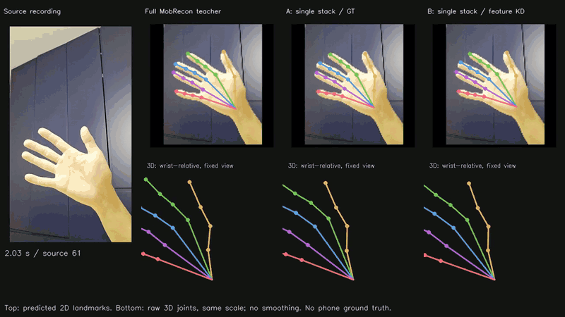

# Hand Mocap Distillation

I started this project to revisit my unfinished [Object Detection Knowledge Distillation](https://github.com/SsisyphusTao/Object-Detection-Knowledge-Distillation) project. With the help of today's coding agents, I want to see how many of my old ideas I can bring to life and what new ideas emerge along the way.

## 1. Plan and achievements

My first plan was to transfer visual features from [WiLoR](https://arxiv.org/abs/2409.12259) to the lighter [MobRecon](https://arxiv.org/abs/2112.02753). Their architectures differ, so I tried feature projections and regional attention inspired by [PAT](https://arxiv.org/abs/2501.08885).

The feature loss decreased, but the completed runs did not improve joint accuracy over supervision alone. See the [WiLoR experiment README](experiments/wilor_transfer/README.md) for details.

I then tried a simpler route: removing MobRecon's first DenseStack and using the full model to teach the resulting single-stack student. This produced a useful result: the student has **44.5% fewer parameters** than the full model. After 38 paired training epochs, feature distillation reduced its development-set MPJPE from **21.76 to 19.22 mm**, an **11.7% improvement** over the same student trained with supervision alone.

## 2. Performance comparison

The four columns show the source recording, the full teacher, supervised student A and distilled student B. The video was recorded on a phone; inference ran on a desktop GPU.

### Training results

I adapted MobRecon's native supervision and trained both students on the same augmented inputs for 38 epochs, using a batch size of 32 and Adam. The learning rate was `1e-3` for the first 30 epochs, then `1e-4` for the final eight. The [single-stack experiment README](experiments/single_stack/README.md) explains the design and methodology.

| Model | Parameters | MPJPE ↓ | PA-MPJPE ↓ |
| --- | ---: | ---: | ---: |
| Full teacher | 12.11M | 14.54 mm | 7.11 mm |
| A: single-stack, supervised | 6.73M | 21.76 mm | 9.32 mm |
| B: single-stack, supervised + feature KD | 6.73M | **19.22 mm** | **8.15 mm** |

These measurements use one seed and the same reused 256-image right-hand development set. MPJPE measures wrist-relative 3D joint error; PA-MPJPE additionally aligns rotation and scale. Distillation recovered some of the accuracy lost through compression.

B had lower development-set MPJPE than A in all 38 epochs. Its relative improvement was about 37% after the first epoch and 11.7% at the fixed final endpoint. Joint-error p95 also fell from 61.57 to 51.46 mm. The [experiment analysis](experiments/single_stack/README.md#results-and-learning-behavior) discusses the convergence pattern and video-scale observations.

## 3. How to run

I keep the execution details in [SETUP.md](SETUP.md), including environment setup, required assets, data preparation, training and evaluation. You can ask your coding agent to read it and help you run the project once the required assets are available. If you want to understand the ideas behind the code, walking through it with an agent can also be a useful way to learn.

## 4. What's next

- Try other ways to transfer knowledge from WiLoR to MobRecon and test whether they improve pose accuracy.
- Deploy the different MobRecon variants on mobile devices and compare their accuracy and end-to-end inference speed.
