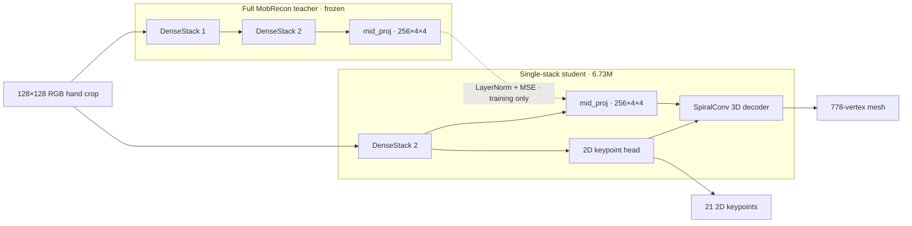
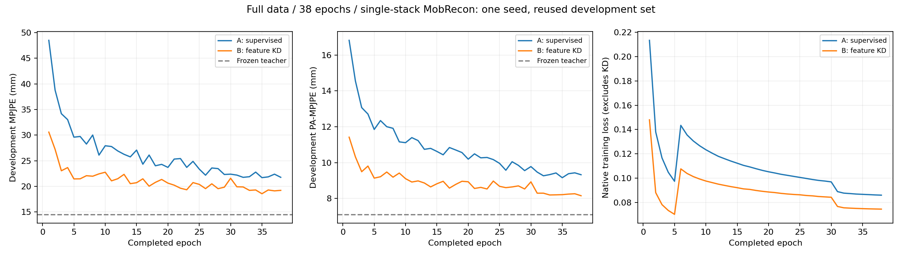

# Full MobRecon → single-stack MobRecon

This experiment asks whether intermediate feature distillation can recover accuracy after removing one of MobRecon's two DenseStack stages. It compares the same smaller student with and without the feature loss. The completed run uses one seed and 38 epochs; its fixed final endpoint is the main comparison.

## Architecture and initialization

The frozen teacher is full MobRecon with **12,114,720 parameters**, initialized from this project's supervised epoch-9 checkpoint. The **6,727,096-parameter** student removes `dense_stack1`, `stack1_remap` and `thrink2`, keeping the input-processing layers, second DenseStack, `mid_proj`, UV head and SpiralConv decoder. The parameter reduction is **44.5%**.

Both students copy the same retained teacher weights and start with fresh Adam optimizers. Student BatchNorm layers train normally; the teacher stays in evaluation mode with gradients disabled. Inputs are non-mirrored right-hand RGB crops, `B×3×128×128`, normalized to `[-1,1]`. The student predicts 21 MPII-order 2D keypoints and a 778-vertex mesh. Mesh coordinates are converted from native units to meters by multiplying by `0.20`; joints are regressed with the shared `j_reg.npy`. The architecture is implemented in [model.py](../../hand_kd/model.py).



The shared input-processing layers are omitted. The dashed edge is the feature-distillation objective used only by arm B during training; the teacher's output heads are omitted from its feature path.

## Paired experiment design

| Setting | Recipe |
| --- | --- |
| Arm A | Native supervision only |
| Arm B | Same supervision + intermediate feature distillation |
| Seed | `20260929` |
| Admitted images | 130,236 FreiHAND + 107,281 CompHand = 237,517 |
| Batch / duration | 32 images / 38 epochs |
| Updates per epoch per arm | 7,422 |
| Image presentations per epoch per arm | 237,504; 13 dropped indices recorded each epoch |
| Total updates per arm | 282,036 |
| Total image presentations per arm | 9,025,152; two augmented views per presentation |
| Optimizer | Adam, zero weight decay |
| Learning rate | `1e-3` for 30 epochs, then `1e-4` for 8 epochs |
| Crop expansion | 1.5× square crop |
| Main endpoint | A versus B at epoch 38 |

Each training image produces two independently augmented views. A and B consume the exact same tensors; the online teacher processes those same `128×128` views in FP32. Augmentation seeds are fixed per sample slot.

The training parameters are defined in [configs/train.json](../../configs/train.json).

## Losses and feature target

Native supervision combines mesh vertices, UV keypoints, normals and edge lengths. From epoch 6, both arms also use two-view consistency losses.

B additionally matches `mid_proj` features of shape `B×256×4×4`. At each spatial location, LayerNorm normalizes the 256 channels independently for teacher and student. The feature objective is the mean squared difference between these normalized features, averaged over the two views:

```text
A: L = L_native
B: L = L_native + 1.0 × mean_over_views(MSE(LN(F_student), LN(F_teacher)))
```

Teacher features are detached. Matching is used only in training; inference loads the student by itself, without teacher weights or an extra alignment head. The target directly feeds the 3D decoder, and its dimensions already match between the two architectures. Implementation: [losses.py](../../hand_kd/losses.py).

## Evaluation methodology

The development set contains 256 right-hand images reused in earlier research. Ground-truth joints come from the labeled manifest; all models use the same frozen detection crops.

- **MPJPE:** mean 3D joint error after subtracting the wrist.
- **PA-MPJPE:** joint error after similarity alignment, including rotation, translation and uniform scale; reflections are disallowed.
- **p95:** the 95th percentile across joint errors.
- **Paired bootstrap:** resample the same development images for A and B to describe uncertainty within this image set.

The fixed epoch-38 comparison is primary. Best development epochs are descriptive. This set is not an independent person/session holdout, and one seed does not establish repeatability across training runs.

## Results and learning behavior

| Model | MPJPE (mm) ↓ | PA-MPJPE (mm) ↓ | Joint-error p95 (mm) ↓ |
| --- | ---: | ---: | ---: |
| Full teacher | 14.539 | 7.114 | 38.021 |
| A: supervised student | 21.764 | 9.324 | 61.567 |
| B: feature-distilled student | 19.219 | 8.153 | 51.462 |

B improves MPJPE by **2.546 mm (11.70%)** and has lower error on 61.72% of the development images. Its p95 improves by 10.105 mm. The paired-bootstrap B−A interval is **[−4.191, −1.078] mm**, describing resampling variation for these 256 images, rather than variation across people, sessions or training seeds.

Both arms have their best development MPJPE at epoch 35: A 21.700 mm and B 18.559 mm. The reported main endpoint remains epoch 38.



The training-loss jump at epoch 6 corresponds to enabling two-view consistency; the change after epoch 30 corresponds to the lower learning rate. B has lower development MPJPE throughout all 38 epochs:

| Stage | A−B MPJPE gap |
| --- | ---: |
| Epoch 1 | 17.9 mm, about 37% |
| Epochs 2–8 | 6.2–11.6 mm |
| Epochs 9–29 | 2.5–6.7 mm |
| Epochs 31–38 | 1.9–3.5 mm |

The [epoch metrics](results/epoch-metrics.json) show faster initial error reduction with distillation and a smaller advantage at the final endpoint.

## Video observations

The [comparison video](../../figures/hand-demo.mp4) is a 17.9-second phone recording with 537 frames: 493 detected-hand frames and 44 missing detections. Inference ran on a desktop GPU.

This recording has no ground truth. The following measurements compare student predictions with **teacher predictions**:

| Teacher-agreement metric | A | B |
| --- | ---: | ---: |
| Raw wrist-relative 3D difference | 31.794 mm | 36.999 mm |
| Similarity-aligned 3D difference | 7.860 mm | 7.165 mm |
| 2D difference in the 128px crop | 3.883 px | 3.334 px |

B is closer in predicted 2D positions and aligned 3D shape, but further away in raw 3D coordinates. The median ratio of total predicted bone length to the teacher's is 1.152 for A and 1.392 for B. This motivates testing an output-level objective and measured scale evaluation.

The 2D overlay uses `uv_pred` directly; the 3D skeleton uses joints regressed from `mesh_pred`. Matching the 2D overlay does not establish correct 3D scale. Raw 3D is shown at a common scale without temporal smoothing or per-frame scale normalization; missing detections remain missing.

## Reproducing the analysis

Training uses the admitted FreiHAND/CompHand data, the supervised full MobRecon epoch-9 checkpoint and the frozen evaluation crops. Recomputing the reported results requires the completed run's per-image predictions and checkpoints from all 38 epochs; the weights and evaluation assets are not bundled.

[analyze.py](analyze.py) recomputes the metrics and paired bootstrap from that run:

```bash
.venv/bin/python -m experiments.single_stack.analyze \
  --run /path/to/completed-run --output outputs/analysis-new
```

The [verified metrics](results/verified-metrics.json) agree with the saved predictions. Independently reloading the final students and repeating development evaluation produced a maximum joint-coordinate difference of `2.98e-8` meters.
